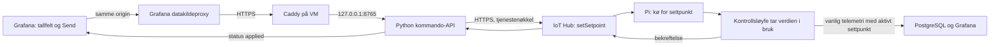

# Statistikk og settpunkt direkte i Azure Managed Grafana

Status: implementert og testet lokalt. Ny API-tjeneste, HTTPS og fjernstyring må
fortsatt installeres og verifiseres live av studenten. Den eksisterende
telemetrikjeden og PostgreSQL-skjemaet beholdes.

## Ny JSON og hva den viser

Importer **deploy/grafana/simulation-control-import.json**. Denne versjonen har
samme dashboard-UID som før og kan erstatte det gamle dashboardet.

- Gjennomsnittlig absolutt avvik: avg(abs(setpoint_c - temperature_c)), i °C.
- Minimum og maksimum rå temperatur i valgt periode, i °C.
- Gjennomsnittlig pådrag i valgt periode, i V.
- De tidligere grafene for temperatur/settpunkt, pådrag og målingsalder.
- Et Business Forms-panel med tallfelt, Send-knapp og status.

Alle statistikkspørringer bruker valgt tidsperiode og Source-filter. Når flere
enheter velges, beregnes statistikken samlet for de valgte målingene. Det er
prøvegjennomsnitt, ikke tidsvektede gjennomsnitt. Tidligere perioder med hyppigere
publisering får derfor større vekt per tidsenhet. Avviket bruker rå målinger,
ikke regulatorens filtrerte signal; rader uten settpunkt utelates fra avviket.
Pådrag i volt er ikke et mål på elektrisk energiforbruk. Ingen nye SQL-kolonner
eller databasemigrering er nødvendig.

## Arkitektur og bekreftelse



Bare settpunkt kan endres. Kp, Ti og filteret er faste. API og Pi avviser andre
felt, ugyldige typer og temperaturer utenfor **25–36 °C**. Alle settpunkt avrundes
til to desimaler. Pi svarer applied først når kontrolltråden har behandlet
kommandoen. Kommandoer som ikke blir behandlet innen to sekunder, forkastes.
En frakoblet Pi gir feil; kommandoen legges ikke i kø til senere oppkobling.
Ved uklart tidsavbrudd må aktivt settpunkt kontrolleres i telemetrien før nytt
forsøk. API-et gjør ikke automatiske kommandoretries.

PostgreSQL-brukeren i Grafana beholder kun lesetilgang. API-et bruker ikke
databasepassord. Azure-tjenestenøkkelen finnes bare i VM-ens private .env.
API-et krever ingen operatørnøkkel. Alle som når API-adressen kan sende settpunkt.
CORS begrenser hvilke nettleseropprinnelser som tillates, men autentiserer ikke brukere.

## Påkrevd datakilde for settpunkt (CSP)

Azure Managed Grafana blokkerer direkte nettleserkall til VM-en gjennom Content
Security Policy (`connect-src`). Panelet bruker derfor Grafanas datakildeproxy.
CORS-endringer på VM-en løser ikke en CSP-blokkering i Grafana.

Før du sender settpunkt:

1. I Grafana: Connections → Data sources → Add new data source → JSON API.
2. Sett **Name** til nøyaktig `airheater-control-api`.
3. Sett **URL** til `https://iotlab1.swedencentral.cloudapp.azure.com`.
4. Bruk Server/Proxy hvis tilgangsmodus vises. Behold TLS-sertifikatvalidering.
5. Lagre datakilden og importer det oppdaterte dashboardet.

Dette er en egen datakilde; behold PostgreSQL-datakilden. Ingen nøkkel kreves.
Panelet finner datakildens UID etter navn og sender én POST til
`/api/datasources/proxy/uid/<uid>/api/setpoint`. Nettleseren bruker sin eksisterende
Grafana-innlogging. VM-API-et har fortsatt ingen operatørautentisering.

Hvis JSON API mangler, aktiver tillegget i Azure-ressursens Plugin management.
Verifiser live med `applied` og oppdatert telemetri; lokale skjematester alene
beviser ikke Azure-proxyens nettverkstilgang eller kommandooverføring.

## 1. Aktiver Business Forms

I Azure Portal: Grafana-ressurs → Plugin management → aktiver
**Business Forms / volkovlabs-form-panel** → Save. Det er bekreftet av studenten
at tillegget finnes i listen. Skjemaet bruker Business Forms 4.4 eller nyere.
Panelet ligger direkte i Grafana; ingen ekstra nettleserfane er nødvendig.

## 2. Oppdater VM og opprett en tjenestenøkkel

På VM:

```bash
cd /home/azureuser/air-heater2
git status --short
git pull --ff-only
```

Behold egne lokale endringer hvis Git melder konflikt; ikke bruk reset.
Den eksisterende database-mottakeren kan fortsette å kjøre. Kontroll-API-et er
en separat prosess, og forbruker ikke hendelser eller checkpoints.

I Azure Portal → IoT Hub **iotlab1** → Shared access policies:

1. Opprett policy **setpoint-controller**.
2. Gi bare **Service Connect**. Ikke gi Registry Read/Write eller Device Connect.
3. Kopier policyens **Primary connection string** til VM-ens .env.

Bruk IoT Hub-tjenestens connection string med HostName og SharedAccessKeyName.
Enhetens DeviceId-string og Event Hubs-kompatibel mottaker-string kan ikke brukes.
Denne policyen gir service-tilgang i huben; API-et begrenser kommandoer videre til
den konfigurerte enheten og den ene metoden. Ikke legg tjenestenøkkelen på Pi-en.

Åpne innstillingene på VM:

```bash
nano .env
```

Legg til disse innstillingene uten å overskrive tidligere innstillinger:

```dotenv
IOTHUB_SERVICE_CONNECTION_STRING=<policyens connection string, kun på VM>
AIRHEATER_CONTROL_DEVICE_ID=airheater-sim-1
AIRHEATER_GRAFANA_ORIGIN=https://iotlab-f5adb6cnhsgka8e8.eno.grafana.azure.com
```

Hold nøklene lokalt; ikke lim dem inn i chat, Git eller JSON. Sett filrettigheter:

```bash
chmod 600 .env
```

Eksisterende miljøvariabler overstyrer .env. Ingen nye Python-biblioteker er
nødvendige ut over python-dotenv, som allerede brukes av mottakeren. Hvis miljøet
mangler dette: `.venv/bin/python -m pip install 'python-dotenv>=1,<2'`.

## 3. Start API-et på VM

I en egen SSH-terminal på VM:

```bash
cd /home/azureuser/air-heater2
.venv/bin/python -u apps/control_api.py
```

Forvent oppstart på **127.0.0.1:8765**. Det skal ikke bindes til 0.0.0.0, og port
8765 skal ikke åpnes i Azure. Kontroller fra en annen VM-terminal:

```bash
curl --fail http://127.0.0.1:8765/health
```

Dette bekrefter bare at API-et kjører, ikke at Pi har mottatt en kommando.

Hvis du senere vil kjøre API-et som tjeneste, stopp den manuelle API-prosessen
først. En valgfri enhet ligger i deploy/airheater-control-api.service:

```bash
sudo install -m 644 deploy/airheater-control-api.service /etc/systemd/system/airheater-control-api.service
sudo systemctl daemon-reload
sudo systemctl enable --now airheater-control-api
systemctl status airheater-control-api --no-pager
```

Dette gjelder bare den nye API-tjenesten, ikke den eksisterende mottakeren.

## 4. Start Pi med fjernstyring aktivert

Stopp gammel kontrollpublisher med Ctrl-C først; behold .state og sekvensnummer.
På Pi:

```bash
cd /home/bjulf/air-heater2
git pull --ff-only
source .venv-azure/bin/activate
python -m unittest discover -s tests -p test_remote_setpoint.py
python -u apps/control_publisher.py --transport azure --continuous --publish-interval 15 --remote-setpoint --setpoint 28
```

I denne modusen starter settpunktet på 28 °C og holdes der til en kommando mottas.
Det automatiske spranget til 34 °C etter 20 s er **deaktivert**. Reguleringen
fortsetter på 10 Hz og telemetrien på hvert 15. sekund. Ved nettverksbrudd brukes
siste godkjente settpunkt mens prosessen kjører. Ved prosess-/Pi-restart starter
den igjen med --setpoint-verdien; et fjernsettpunkt lagres ikke permanent.
Det finnes ingen ekstra inngående port eller server på Pi-en.

## 5. Test kommandoen fra VM før Grafana

Mens API og Pi kjører, i en annen terminal på VM:

```bash
cd /home/azureuser/air-heater2
.venv/bin/python apps/check_setpoint.py 32
```

Forvent svar med **status applied, setpoint_c 32.0 og device_id airheater-sim-1**.
Verktøyet sender uten operatørnøkkel.
Hvis Pi er offline, ikke kjører med --remote-setpoint eller ikke kan bekrefte
kommandoen, skal testen feile i stedet for å rapportere applied.

Innen omtrent ett publiseringsintervall skal nye rader ha settpunkt 32:

```sql
SELECT measured_at, temperature_c, setpoint_c, heater_voltage
FROM public.simulation_measurements
WHERE device_id = 'airheater-sim-1' AND setpoint_c IS NOT NULL
ORDER BY measured_at DESC LIMIT 10;
```

## 6. HTTPS på VM for Azure Managed Grafana

Studentens oppgitte VM-navn er **iotlab1.swedencentral.cloudapp.azure.com**.
DNS-navnet må peke på den aktuelle VM-en. Bruk dette navnet, ikke den numeriske
IP-adressen, i nettleseren og dashboardet.

I VM-ens Azure Network Security Group åpnes innkommende TCP **80 og 443** for
HTTP-validering av sertifikat og HTTPS. Behold SSH-regelen. Hvis Ubuntu-brannmur
er aktiv, tillat disse portene der også. Port 8765 beholdes lukket eksternt.

Installer Caddy på Ubuntu dersom den ikke allerede finnes:

```bash
sudo apt update
sudo apt install caddy
```

Hvis pakken ikke finnes i aktivert apt-kilde, bruk den offisielle
[Ubuntu-installasjonsveiledningen](https://caddyserver.com/docs/install#debian-ubuntu-raspbian).
Hvis VM-en allerede har en webserver på 80/443, må rutingen samordnes med den
før Caddy startes. Ikke stopp eksisterende webtjenester ukritisk.

Legg denne site-blokken til /etc/caddy/Caddyfile. En kopi ligger i
deploy/control.Caddyfile. Behold eventuelle eksisterende nettsteder:

```caddyfile
iotlab1.swedencentral.cloudapp.azure.com {
    reverse_proxy 127.0.0.1:8765
}
```

```bash
sudo nano /etc/caddy/Caddyfile
sudo caddy validate --config /etc/caddy/Caddyfile --adapter caddyfile
sudo systemctl reload caddy
curl --fail https://iotlab1.swedencentral.cloudapp.azure.com/health
```

Caddy henter og fornyer et offentlig sertifikat når DNS og portene er riktige.
Ikke bruk --insecure eller slå av sertifikatkontroll. Ved problemer sjekkes
`journalctl -u caddy -n 40 --no-pager`. API-et krever ingen operatørnøkkel; behold HTTPS og temperaturvalideringen.

## 7. Importer dashboardet og send fra Grafana

1. Last ned deploy/grafana/simulation-control-import.json fra GitHub.
2. Dashboards → New → Import → last opp filen.
3. Velg den eksisterende PostgreSQL-datakilden. Erstatt tidligere dashboard ved
   spørsmål om samme UID. Dette endrer ikke databasen.
4. Se at de tre statistikkpanelene viser verdier for valgt tidsperiode.
5. I **Change Pi setpoint**: velg eksempelvis **30.00 °C**.
6. Klikk **Send setpoint**.
7. Vent på status **airheater-sim-1: 30.00 °C applied** i samme panel.
8. Innen neste telemetrimelding skal settpunktkurven og SQL-radene vise 30 °C.

Det finnes ikke noe Control key-felt. Azure-connection-stringen beholdes privat på VM-en.

API-adressen konfigureres i JSON API-datakilden `airheater-control-api`.
Hvis VM-navnet endres, oppdater datakildens URL og Caddyfile.
Source-filteret påvirker statistikk og grafer. Kommandopanelet styrer bare den
ene enheten API-et er konfigurert for, airheater-sim-1.

API-et tillater én kommando av gangen og minst ett sekund mellom kommandoer.
Kun et positivt applied-svar fra Pi gir grønn bekreftelse. Ved feil vises en
forklaring i panelet. Ved tvetydig timeout, sjekk telemetrien før nytt forsøk.

## Tester og begrensninger

Lokal Windows-verifikasjon: 31 unittest-tester kjørt, 28 bestått og 3 hoppet over
(ekte PostgreSQL uten test-DSN og to Linux-spesifikke låstester). Skjemakoden
bestod også Node-testene for bekreftelse, feil, validering og sending uten operatørnøkkel.

```bash
python -m unittest discover -s tests
node tests/test_setpoint_form.mjs
```

Testene bruker falske Azure-svar og lokal HTTP. De kontrollerer streng validering,
sending uten operatørnøkkel, CORS, feil/timeouts, ingen automatisk retry av kommandoer,
bekreftelse fra faktisk simulert kontrollsløyfe, videre telemetri, tømming av
passordfelt og at JSON-payloaden bare inneholder settpunkt. De bekrefter ikke
tilgang til ekte IoT Hub eller at grafanatillegget er installert på serveren.

Node trengs bare for utviklingstesten av skjemakoden, ikke for Pi eller VM-API-et.
Eksisterende databaseintegrasjonstest kjøres bare når et disponibelt test-DSN
er konfigurert. Kjør ikke feiltester mot den aktive enhetens .state.

Gjenstående live-akseptanse: lokalt API-testkall, TLS med gyldig sertifikat,
sendeforsøk fra det importerte Grafana-panelet, bekreftelse i telemetrien,
avvisning av ugyldig verdi og feil ved frakoblet Pi. Det er ikke installert
ny programvare eller endret Azure-konfigurasjon automatisk fra denne chatten.

## Kilder

- [Business Forms og REST API](https://grafana.com/docs/plugins/volkovlabs-form-panel/latest/rest-api/)
- [Business Forms custom code](https://grafana.com/docs/plugins/volkovlabs-form-panel/latest/custom-code/)
- [Azure Managed Grafana plugin management](https://learn.microsoft.com/en-us/azure/managed-grafana/how-to-manage-plugins)
- [IoT Hub Invoke Method REST API](https://learn.microsoft.com/en-us/rest/api/iothub/service/devices/invoke-method?view=rest-iothub-service-2021-11-30)
- [Azure Python SDK: direct method handler](https://github.com/Azure/azure-iot-sdk-python/blob/main/samples/async-hub-scenarios/receive_direct_method.py)
- [Caddy automatic HTTPS](https://caddyserver.com/docs/automatic-https)
