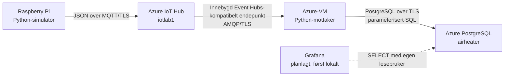

# LAB 3 – konfigurasjon og presentasjonsnotater

## Ny kontrolltelemetri klargjort lokalt 15. november 2026

`apps/control_publisher.py` kombinerer den analyserte 10 Hz PI-reguleringen med
1 Hz Azure-telemetri (temperatur, settpunkt og pådrag). Filter og faste regulatorparametere
beholdes lokalt på Pi; cloud brukes bare til overvåking. Ny mottaker, settpunktkolonne
og oppdatert dashboard er klargjort. **Denne versjonen er ikke live-verifisert ennå.**
Følg [CONTROL_TELEMETRY.md](CONTROL_TELEMETRY.md) for Git-oppdatering og akseptansetest.
Resten beskriver den tidligere verifiserte åpne kjeden.

Sist oppdatert: 15. november 2026. Dokumentet bygger på kildekoden, brukerens terminalutskrifter og skjermbilder fra Azure/pgAdmin. Det inneholder ingen passord eller tilgangsnøkler. Azure-innstillinger som bare ble anbefalt, er merket særskilt.

## 1. Kort forklaring til presentasjonen

«Vi simulerer en luftvarmer på Raspberry Pi og sender én måling per sekund til Azure IoT Hub. En separat Python-mottaker på en Azure-VM validerer meldingene og lagrer dem i Azure Database for PostgreSQL. Hver måling identifiseres med enhets-ID og et vedvarende sekvensnummer. Etter at målingen er lagret, oppdaterer mottakeren et checkpoint, slik at den kan fortsette etter et avbrudd. Grafana skal lese dataene med en egen bruker som bare har lesetilgang.»

Siste setning beskriver planlagt overvåking. Grafana er ikke koblet til ennå.

## 2. Arkitektur og ansvarsfordeling



- Simulatoren lager data, men har ikke databasepassord.
- IoT Hub tar imot enhetsmeldinger og gjør dem tilgjengelige i en partisjonert strøm.
- Mottakeren håndterer validering, innsetting, retry og checkpoints.
- PostgreSQL lagrer målinger og leseposisjoner permanent.
- Grafana skal vise historikk og ferskhet. Det trengs ingen lokal kopi av målingstabellen.
- Ingen separat Event Hub eller Azure Storage-konto brukes til denne mottakerens checkpoints.
- Nåværende kjede kjører uten PI-regulator. Kontrollkode finnes fra før, men brukes ikke av simulatorpublisheren.
- ROS/C++ i `air_heater_ws` videreutvikles ikke. Eldre MQTT/SQLite/SQL Server-kode bruker et annet skjema og er ikke den aktive Azure-kjeden.
- Docker Compose finnes som et lokalt alternativ i repoet, men brukes ikke i Azure-oppsettet som er demonstrert.

## 3. Ressurser og miljø

| Del | Konfigurasjon / status |
|---|---|
| Azure-abonnement | Azure for Students |
| Ressursgruppe | `iotlab` |
| IoT Hub | `iotlab1`, Free tier oppgitt i prosjektets utgangspunkt |
| Enhet | `airheater-sim-1` |
| Lesepolicy | `airheater-receiver`, opprettet med Service Connect alene etter veiledningen |
| Consumer group | `airheater-postgres`, bekreftet i databasecheckpoint |
| PostgreSQL-ressurs | `iotlab-server2` (den vellykkede opprettelsen; tidligere navn/forsøk var `iotlab-server`) |
| Databasevertsnavn | `iotlab-server2.postgres.database.azure.com` |
| PostgreSQL-region | Norway East |
| PostgreSQL-versjon | 18.6, vist i serverens Overview |
| Databasekapasitet | Burstable B1ms, 1 vCore, 2 GiB RAM, 32 GiB lagring |
| PostgreSQL-sone | 1, vist i Overview |
| Høy tilgjengelighet | Ikke aktivert, vist i Overview |
| Database | `airheater` |
| Skjema | `public` |
| Databaseadministrator | `bjulf` |
| VM | `airheater-receiver` |
| VM-region | Sweden Central i siste opprettelsesoversikt |
| VM-størrelse | Standard B2ats_v2, x64, 2 vCPU / 1 GiB RAM ifølge størrelseslisten |
| VM-operativsystem | Ubuntu Server 24.04 LTS |
| Python på VM | 3.12.3, kontrollert i SSH |
| VM-bruker | `azureuser`, passordinnlogging via SSH |
| VM offentlig IP | Sist bekreftet `135.225.80.21`; kontroller gjeldende adresse etter stopp/start |
| VM-sikkerhet | Trusted launch, Secure Boot og vTPM aktivert i opprettelsesoversikten |
| Kode på VM | `/home/azureuser/air-heater2` |
| Python-miljø på VM | `/home/azureuser/air-heater2/.venv` |
| Kode på Pi | `/home/bjulf/air-heater2` |
| Python-miljø på Pi | `.venv-azure`, Python 3.12 |
| Pi-operativsystem | Ubuntu 26.10 ARM64, oppgitt i prosjektets utgangspunkt |
| Repo | https://github.com/bjulf/air-heater2 |

Lokal kode ligger i `C:\Users\BjornErikUlveraker\OneDrive - ZEM AS\Studier\IoT and Cybersec\LAB 3\code`, som er Git-repoet.

Lagring ble konfigurert som 32 GiB Premium SSD/P4 (120 IOPS), uten autogrow, på PostgreSQL. Sju dagers backup og avslått geo-redundans ble anbefalt; endelig backupkonfigurasjon bør bekreftes i portalen før presentasjonen. Service-managed krypteringsnøkkel ble valgt i opprettelsesdialogen.

For VM ble Standard SSD LRS og sletting av offentlig IP/NIC sammen med VM anbefalt etter første prisoversikt. Endelig disktype og slettingsvalg er ikke dokumentert i et etterfølgende skjermbilde. Ikke presenter anbefalte valg som verifisert konfigurasjon.

## 4. Simulator og prosessmodell

Publisher: `apps/simulator_publisher.py`. Modell: `airheater/simulation/model.py`.

Førsteordens prosess med transportforsinkelse:

```text
dTout/dt = (-Tout + Kh*u(t-theta_d) + Tenv) / theta_t
```

| Parameter | Verdi |
|---|---|
| Forsterkning Kh | 3,5 °C/V |
| Tidskonstant theta_t | 22 s |
| Transportforsinkelse theta_d | 2 s |
| Omgivelsestemperatur Tenv | 21,5 °C |
| Tillatt pådrag | 0–5 V |
| Standard steg | 0 til 2 V |
| Måleintervall | 1 s |
| Publisherens diskretisering | ZOH (eksakt for holdt inngang over intervallet) |
| Målemodell | Støy med standardavvik 0,1 °C, seed 42 |

Ved konstant 2 V er modellens stasjonære temperatur 21,5 + 3,5*2 = 28,5 °C. En 30-sekunders test rekker ikke nødvendigvis dit. Målingen tas ved starten av intervallet; `heater_voltage` er inngangen som brukes over det følgende intervallet.

JSON-formatet har nøyaktig disse feltene:

```json
{
  "schema": "airheater.simulation.v1",
  "device_id": "airheater-sim-1",
  "sequence_number": 140,
  "timestamp": "2026-11-14T15:47:51.499927+00:00",
  "elapsed_seconds": 29,
  "temperature_c": 25.813521690375108,
  "heater_voltage": 2
}
```

Eksemplet kombinerer observerte identitets-/temperaturverdier med formatet i koden. IoT Explorers `body`-innpakning er ikke en del av publisherens JSON. IoT Hub-enqueue-tid er separat metadata.

## 5. Identitet og buffering på Pi

- Målingens unike identitet er `(device_id, sequence_number)`, uten UUID eller run_id.
- Telleren lagres i `.state/airheater-sim-1.sequence` og reserveres før enqueueing.
- Telleren skal bevares mellom kjøringer; ikke slett/nullstill `.state`.
- En låsefil hindrer samtidige publishere med samme lokale counterfil.
- Azure `message_id` er `<device_id>:<sequence_number>`.
- RAM-kø: 300 ventende meldinger pluss opptil én under sending.
- Ved sendefeil prøves samme serialiserte melding på nytt etter to sekunder.
- Ved full kø avvises nyeste måling, og det rapporteres. Hull i sekvensnumre er derfor lovlig.
- Normal avslutning venter opptil ti sekunder på tømming. Krasj/omstart mister usendte RAM-meldinger.
- Ingen SQLite-buffer er brukt; dette var et bevisst prosjektvalg.
- En sendebekreftelse fra IoT Hub betyr ikke at målingen allerede er lagret i PostgreSQL.

## 6. Mottaker og validering

Filer:

| Fil | Oppgave |
|---|---|
| `apps/azure_receiver.py` | Oppstart, secrets, Event Hubs-klient og PostgreSQL-tilkobling |
| `airheater/telemetry/ingestion.py` | JSON-validering og commit-før-checkpoint |
| `airheater/storage/postgres_simulation.py` | Parameterisert innsetting og checkpointlager |
| `apps/check_postgres.py` | Tilkoblingsdiagnostikk uten rå feilmeldinger eller secrets |
| `tests/test_ingestion.py` | Offline feilhåndteringstester og valgfri databaseintegrasjonstest |

Avhengigheter installeres med `python -m pip install -e '.[receiver]'`: azure-eventhub 5.x, psycopg 3.x med binary-ekstra og python-dotenv 1.x. Eksakte installerte patchversjoner på VM er ikke dokumentert; bruk `python -m pip show azure-eventhub psycopg python-dotenv` ved behov.

Validering før databaseinnsetting:

- Maksimalt 4096 byte fra event-body før JSON-dekoding.
- JSON-objekt med nøyaktig det forventede feltsettet og riktig schema-verdi.
- Dupliserte JSON-nøkler avvises.
- Device ID: 1–64 bokstaver/sifre/understrek/bindestrek; første tegn bokstav eller siffer.
- Payloadens device ID må stemme med IoT Hubs autentiserte `iothub-connection-device-id`.
- Sekvensnummer: heltall 1 til 9223372036854775807. Bool godtas ikke som tall.
- Endelige numeriske verdier; NaN, infinity og strenger godtas ikke.
- Temperatur -50 til 150 °C, pådrag 0–5 V, elapsed 0–315360000 s.
- Tidsstempel må inneholde tidssone og normaliseres til UTC.
- Måletid må være fra 2020 og ikke mer enn fem minutter frem i tid mot mottakerens klokke.
- Ugyldige hendelser logges som avvist og checkpointes bevisst, slik at de ikke blokkerer strømmen. Det finnes ingen karantene/dead-letter-tabell.

## 7. Databasestruktur

### public.simulation_measurements

| Kolonne | Datatype | Betydning |
|---|---|---|
| device_id | varchar(64) | Kildeidentitet |
| sequence_number | bigint | Publisherens vedvarende sekvensnummer |
| measured_at | timestamptz | Måletid fra payloadens timestamp |
| elapsed_seconds | double precision | Tid siden denne simuleringen startet |
| temperature_c | double precision | Temperatur i °C |
| heater_voltage | double precision | Pådrag i V |
| enqueued_at | timestamptz | IoT Hubs mottakstid fra event-metadata |
| received_at | timestamptz | Databasens klokke ved INSERT, DEFAULT clock_timestamp() |

Alle kolonner er NOT NULL. Primærnøkkel: `(device_id, sequence_number)`. Ekstra indeks: `(device_id, measured_at DESC)` for kilde-/tidsoppslag. Tallgrenser og device-format håndheves også med database-CHECK.

`timestamptz` representerer absolutte tidspunkt; visning følger sesjonens tidssone. Koden normaliserer til UTC, og applikasjonsrollene ble satt til UTC. De tre tidspunktene gjør det mulig å skille måletid, skyankomst og databaselagring. Forskjeller påvirkes også av klokkeavvik og er ikke automatisk ren nettverksforsinkelse.

### public.receiver_checkpoints

| Kolonne | Datatype | Betydning |
|---|---|---|
| namespace | text | Event Hubs-kompatibelt namespace |
| hub | text | Hub/entity-navn fra faktisk endepunkt |
| consumer_group | text | Uavhengig lesergruppe |
| partition_id | text | Partisjon i strømmen |
| event_offset | text | Sist ferdigbehandlede posisjon |
| sequence_number | bigint | Azure-partisjonens eget sekvensnummer |

Primærnøkkel: `(namespace, hub, consumer_group, partition_id)`.

Azure-sekvensnummeret er forskjellig fra simulatorens sekvensnummer. Én rad per brukt partisjon/gruppe er forventet; det er ikke én checkpoint-rad per måling.

## 8. Transaksjoner, duplikater og checkpoints

1. Les og valider hendelsen.
2. Kjør en parameterisert INSERT med `ON CONFLICT (device_id, sequence_number) DO NOTHING`.
3. Commit databasetransaksjonen.
4. Oppdater checkpointet i en separat databasetransaksjon.
5. Gå videre på partisjonen først når checkpointoppdateringen lykkes.

Ved database-/checkpointfeil prøver callbacken igjen hvert andre sekund. Tilkoblingstimeout er 10 sekunder og SQL statement_timeout 15 sekunder. SDK-et håndterer Azure-forbindelsens egne retries.

Ved krasj mellom steg 3 og 4 kan samme hendelse leses igjen. Primærnøkkel og ON CONFLICT gir idempotent lagring: den første lagrede raden beholdes, inkludert opprinnelig received_at. Vi påstår ikke exactly-once-levering fra nettverket.

Muntlig forklaring: «Vi lagrer målingen før vi flytter bokmerket. Ved krasj leser vi heller samme melding igjen enn å hoppe over den. Databasens unike nøkkel hindrer at den lagres dobbelt.»

Uten checkpoint leser mottakeren fra eldste fortsatt tilgjengelige event (`starting_position='-1'`). Azure oppbevarer ikke meldinger ubegrenset; et langt avbrudd kan gi tap etter utløpt retention. Publisherens RAM-kø er heller ikke permanent.

Adapterens eierskap til partisjoner er i minnet, mens checkpointposisjonene er i PostgreSQL. **Kun én mottaker per dedikerte consumer group på tvers av alle maskiner.** Dette er ikke et distribuert lease-oppsett. `.state/azure_receiver.lock` hindrer en ekstra lokal prosess i samme checkout. Ny Linux-kode bruker flock på `.state/azure_receiver.process.lock`, som frigjøres av OS ved prosessdød. Denne filen skal ikke slettes. En eventuell gammel `.state/azure_receiver.lock` blokkerer migrering og må undersøkes manuelt etter bekreftet stopp. Windows beholder tidligere eksistenslås. Se `deploy/SYSTEMD.md`.

## 9. Brukere, secrets og nettverk

| Identitet | Rettigheter / bruk |
|---|---|
| IoT-enheten | Device connection string på Pi, publisering fra den registrerte enheten |
| airheater-receiver-policy | Service Connect for mottak fra IoT Hub; ingen behov for Registry Write eller iothubowner |
| bjulf | PostgreSQL-administrator, brukt i pgAdmin til oppsett |
| airheater_ingest | CONNECT/USAGE, INSERT/SELECT på målinger, INSERT/SELECT/UPDATE på checkpoints |
| airheater_grafana | CONNECT/USAGE og SELECT bare på målinger; ingen checkpoints-tilgang gitt |

Begge applikasjonsroller har egne passord og Can login aktivert av brukeren. Ingen superuser-, createdb- eller createrole-rettigheter ble gitt. Grafana-rollen har default_transaction_read_only=on og statement_timeout=15s. Den reelle skrivebeskyttelsen er manglende skriverettigheter; standard read-only er et tillegg.

Oppsettet fjernet PUBLICs CREATE på public-skjemaet og PUBLICs databaserettigheter, og ga applikasjonsrollene eksplisitt CONNECT/USAGE. De seks tabellrettighetene ble vist i pgAdmin. Faktiske skriveavvisninger som Grafana-bruker er ennå ikke testet.

- PostgreSQL bruker offentlig endepunkt, port 5432, med IP-brannmur.
- PC-ens daværende offentlige IP ble lagt til for administrasjon/lokal Grafana.
- VM-adressen `135.225.80.21` ble oppgitt som egen firewallregel. At tilkoblingen fungerer, er bekreftet. Hele effektive brannmurregelsettet er ikke eksportert.
- «Allow public access from any Azure service» ble holdt avslått etter veiledningen. Dette valget gjelder ellers Azure-ressurser også i andre kunders abonnementer.
- VM ble valgt med Basic NSG og SSH 22 åpen fra internett. Dette er et dokumentert labkompromiss: hvem som helst kan forsøke innlogging, og VM-en inneholder følsomme tilkoblingsnøkler. Videre forbedring er SSH-nøkkel og kilde-IP-begrensning.
- Trafikken til IoT Hub bruker TLS. Publisher bruker normalt MQTT/TLS 8883, alternativt WebSockets 443; receiver bruker AMQP/TLS, normalt 5671.
- PostgreSQL-DSN bruker sslmode=verify-full og VM-ens CA-fil `/etc/ssl/certs/ca-certificates.crt`.
- pgAdmin på Windows ble satt opp med verify-full og lokal fil `certificates/azure-postgresql-roots.pem`, laget fra offentlige Microsoft/DigiCert-rotsertifikater. Observerte SQL-resultater bekreftet TLSv1.3; pg_stat_ssl alene bekrefter kryptering, ikke klientens verify-full-konfigurasjon.
- PEM beskriver filformat, ikke hemmelighetsgrad. Denne rotsertifikatfilen er offentlig; en privat SSH-nøkkel i PEM ville vært hemmelig.
- Secrets ligger i repoets `.env` på de respektive maskinene; på VM satt med chmod 600. Dette er klartekst med filrettigheter, ikke Key Vault.
- Pi: IOTHUB_DEVICE_CONNECTION_STRING. VM: IOTHUB_EVENTHUB_CONNECTION_STRING, IOTHUB_CONSUMER_GROUP og AIRHEATER_POSTGRES_DSN.
- Eksisterende miljøvariabler har prioritet over .env. python-dotenv bruker override=False og interpolate=False.
- .env, virtuelle miljøer og .state er ignorert av Git. Ikke vis .env, passord, SAS-nøkler eller komplette connection strings på slides.
- Logger viser feiltype/kategorier fremfor rå unntakstekst for å unngå lekkasje. Normalt logges ikke hver lagrede måling.

Pi-nettverket er ikke endret: statisk Ethernet 192.168.250.99/24 beholdes; Wi-Fi via hotspot var stabilt. Sist oppgitte hotspotadresse var 172.20.10.13 og kan endres. Disse IP-ene er ikke VM-ens databasebrannmuradresse.

## 10. Feil vi møtte og hvordan de ble løst

| Problem | Observasjon og løsning |
|---|---|
| Azure SDK på Pi/Python 3.14 | ssl.PROTOCOL_TLSv1_2 manglet; separat Python 3.12-miljø løste sending |
| PostgreSQL i Denmark East | Abonnementspolicy avviste regionen |
| PostgreSQL i Sweden Central | SkuNotAvailable; ny opprettelse lyktes i Norway East |
| VM i Norway East | B2ats_v2 og D2s_v3 ga NotAvailableForSubscription; VM opprettet i Sweden Central |
| Kode manglet på VM | GitHub hadde ennå ikke mottakerfilene; commit/push fra PC og pull på VM løste det |
| Mottaker viste bare «Azure receive error» | Loggen ble endret til å vise unntakets klassenavn uten secrets |
| OperationalError ved oppstart | PostgreSQL brukes til checkpoints også før nye målinger; en slik feil trenger ikke være IoT Hub-feil |
| Databasesjekk: Password authentication failed | Passord ble endret på ingest-rollen og oppdatert i VM-ens .env; ny sjekk lyktes |

Lokal kode ble pushet til GitHub og hentet på VM. Verifiserte lokale commitreferanser ved dokumentasjon: `37b4fef` mottaker, `da16abf` feiltype i logg, `87259f8` database-diagnostikk. Presentasjonsnotatene og enkelte deploy-filer er lokale/ikke automatisk pushet.

## 11. Hva som faktisk er verifisert

| Kontroll | Resultat |
|---|---|
| Pi -> IoT Hub | Tidligere sett i Azure IoT Explorer |
| VM Python | 3.12.3 |
| Offline mottakertester på VM | 7 testtilfeller, 6 bestått og 1 eksplisitt hoppet over |
| check_postgres.py på VM | Tilkobling OK, lesing av begge tabeller OK, TLS active=True |
| PC/pgAdmin | Database airheater, bruker bjulf, TLS true og TLSv1.3 |
| Ende til ende til database | pgAdmin viste målinger fra airheater-sim-1 med omtrent ett sekund mellom måletidspunktene |
| Konkret måling | Sekvens 140, 2026-11-14 15:47:51.499927 UTC, temperatur ca. 25,8135 °C |
| Persistens av checkpoint | pgAdmin viste consumer group airheater-postgres, partisjon 1, offset 34952, Azure-sekvens 59 |
| Testet omstart og gjenopptakelse | Live bekreftet 15. november: sekvens 151–160 sendt under stopp og lagret etter manuell oppstart; se del 17 |
| Live retry etter databaseutfall | Ikke bekreftet gjennomført |
| Live duplikatreplay | Ikke bekreftet gjennomført |
| Live ugyldige meldinger | Ikke bekreftet gjennomført |
| Grafana | Ikke koblet til; lokal dashboard/provisioning finnes |
| systemd | Enhet og installasjonsveiledning implementert lokalt 15. november; ikke installert eller live verifisert på VM |

Tidligere lokal regresjon: 42 modell/analys tester, 41 eldre telemetritester, 2 publishertester og 6 nye mottakertester besto (91 bestått totalt). Eldre telemetritester gjelder separat MQTT/SQLite-kode og er ikke et bevis på den nye Azure-kjeden. Valgfri PostgreSQL-integrasjonstest var hoppet over uten disponibel testdatabase. Offline-tester dekker blant annet duplikatnøkler i JSON, ugyldige typer/tall/tidspunkter, parameterbinding, retryrekkefølge og checkpointfeil. Ekte duplikat-INSERT-test ligger i den valgfrie integrasjonstesten.

## 12. Demo og gjenoppstart

Kontroller at VM og PostgreSQL er startet. VM-ens tilstand ved slutten av økten er ikke bekreftet; Stop/deallocate ble bare foreslått. Start ikke flere mottakere samtidig.

På PC:

```powershell
ssh azureuser@135.225.80.21
```

På VM:

```bash
cd ~/air-heater2
source .venv/bin/activate
python apps/check_postgres.py
python apps/azure_receiver.py
```

På Pi i et annet terminalvindu:

```bash
cd ~/air-heater2
source .venv-azure/bin/activate
python -u apps/simulator_publisher.py --transport azure --duration 30 --step-at 5
```

I pgAdmin Query Tool mot airheater:

```sql
SELECT device_id, sequence_number, measured_at,
       temperature_c, heater_voltage, enqueued_at, received_at
FROM public.simulation_measurements
ORDER BY received_at DESC
LIMIT 40;

SELECT consumer_group, partition_id, event_offset, sequence_number
FROM public.receiver_checkpoints
ORDER BY consumer_group, partition_id;
```

Kjør SQL på nytt for å oppdatere resultatet; pgAdmin-tabellen oppdateres ikke kontinuerlig av seg selv. Python-mottakeren kan være stille etter oppstart selv om den lagrer data. Mottakerens oppstartslinje alene beviser ikke at forbindelsene er i orden.

Illustrerende test av gjenopptakelse (fortsatt ugjennomført): noter antall rader og høyeste sekvens, stopp receiver, send 10 målinger fra Pi, start receiver, bekreft at nye sekvenser og checkpoint kommer inn. Ikke nullstill counter eller slett checkpoints for å demonstrere dette.

## 13. Kostnader og driftsvalg

Siste viste ordinære computepris for VM var 0,0097 USD/time, ca. 7,08 USD ved 730 timer; dette er ikke totalpris eller bekreftet fakturering. Studentfordeler/kreditt kan redusere kostnad. Disk og offentlig IP må vurderes separat. PostgreSQL-gratisfordel ble valgt som mål med B1ms/32 GiB, men faktisk forbruk/tilgjengelig gratisperiode ble ikke kontrollert på kontoen. Ikke presenter oppsettet som garantert kostnadsfritt.

IoT Hub Free var oppgitt med 8000 meldinger/dag. Én melding per sekund blir 86400 målinger/døgn, så dette oppsettet er demonstrert med korte kjøringer, ikke kontinuerlig døgnpublisering på Free. Rundt 8000 målinger tilsvarer 2 timer og 13 minutter ved 1 Hz, før annen kvotebelastning.

Azure Managed Grafana ble vurdert, men ikke opprettet. PostgreSQL kan brukes både fra lokal Grafana og Managed Grafana Standard. Databasen trenger ikke byttes for å flytte dashboardet. Ingen ekstra VM for Grafana er opprettet.

Bakgrunn: [Studenttilbud](https://azure.microsoft.com/en-us/free/students), [Managed Grafana-datakilder](https://learn.microsoft.com/en-us/azure/managed-grafana/how-to-data-source-plugins-managed-identity), [Azure PostgreSQL TLS](https://learn.microsoft.com/en-us/azure/postgresql/security/security-tls-how-to-connect). Tilbud og priser må sjekkes på nytt før de brukes som aktuelle pristall.

## 14. Neste arbeid og foreslått presentasjonsrekkefølge

Neste tekniske steg:

1. Legg en systemd-enhet og veiledning i Git. Kjør som azureuser med eksisterende .venv/.env, automatisk oppstart og restart. Stopp manuell receiver før tjenesten startes.
2. Test kontrollert omstart og gjenopptakelse; dokumenter antall rader/checkpoint før og etter.
3. Koble lokal Grafana til Azure PostgreSQL som airheater_grafana med verify-full og riktig CA; tillat PC-ens gjeldende offentlige IP.
4. Importer/tilpass dashboard for temperatur, pådrag, kildevalg, tidsintervall og alder på siste måling. Den lokale provisioningfilen peker foreløpig mot Docker-postgres med sslmode=disable og skal ikke brukes uendret mot Azure.
5. Gjennomfør live tester av duplikater, ugyldige meldinger, databaseutfall og Grafana-brukerens skriveforbud.
6. Dokumenter skjermbilder og vurder til slutt regulatorintegrasjon. Ingen regulator er i den demonstrerte telemetrikjeden.

Forslag til 7 presentasjonsdeler:

1. Problem og valgt arkitektur: hvorfor skille prosess, mottaker, lagring og visning.
2. Simuleringsmodell og stegtest: parametere, forsinkelse, 1 Hz, uten regulator foreløpig.
3. JSON og identitet: vedvarende sekvensnummer og tre tidsstempler.
4. Azure-ressurser og databasens to tabeller.
5. Sikkerhet: TLS, minst mulige rettigheter, hemmeligheter utenfor Git, dokumentert SSH-kompromiss.
6. Pålitelighet: RAM-kø, retry, unik nøkkel, checkpoint etter commit og kjente tapsgrenser.
7. Live dokumentasjon, lærdom fra feil, kostnader og gjenstående systemd/Grafana-arbeid.

Bruk SQL-resultatet med sekvens 140 og checkpointbildet med sekvens 59 som dokumentasjon. Forklar eksplisitt hvorfor disse to sekvensnumrene er ulike. Ikke vis personlige kontaktopplysninger, abonnement-ID, passord eller tilgangsnøkler på slides.

## 15. Lokal filstatus å være oppmerksom på

Ved gjennomlesing til dette notatet inneholdt `deploy/azure_roles.sql` nå en SELECT for målingsvisning, ikke det opprinnelige rolleoppsettet. Det ser ut til at filen er blitt lagret fra Query Tool med ny tekst. Den er ikke endret tilbake her. Ikke bruk den som rolleopprettingsskript uten å gjenopprette riktig innhold. De faktiske rettighetene er dokumentert fra det vellykkede pgAdmin-resultatet og tabellen over.

## 16. Systemd-arbeid 15. november 2026

Implementert: deploy/airheater-receiver.service og deploy/SYSTEMD.md med azureuser, eksisterende .env, boot-oppstart, restart og journallogger. Linux bruker nå OS-lås uten automatisk sletting av låsefiler. Kun én mottaker per consumer group gjelder fortsatt.

Lokalt testet på Windows/Python 3.14: 6 ingestion-tester bestått, 1 PostgreSQL-integrasjonstest hoppet over. De 2 nye Linux-låsetestene er hoppet over på Windows og må kjøres på VM. git diff --check bestått. SSH-forsøk fra arbeidsmiljøet ga Permission denied på nettverksforbindelsen; dette fastslår ikke VM-ens tilstand. Ingen installasjon, live restart, etterslepstest eller Grafana-tilkobling er verifisert i denne økten.

## 17. Live gjenopptakelse 15. november 2026

Bekreftet fra brukerens VM-terminal og pgAdmin-resultater:

- Mottakeren var stoppet mens Pi sendte ti målinger, simulatorsekvens 151–160.
- Måletidene var 12:54:00.669339–12:54:09.667596 UTC.
- Etter manuell oppstart ble alle ti lagret med received_at fra 12:56:14.406612 til 12:56:18.497584 UTC. Dataene ble altså hentet inn etter omtrent to minutters stopp; intervallene er ikke et mål på vanlig nettverksforsinkelse.
- Checkpoint for airheater-postgres, partisjon 1, gikk fra offset 40896 / Azure-sekvens 69 til offset 46840 / Azure-sekvens 79.
- Simulatorsekvens og Azure-sekvens er fortsatt ulike tellere. Ingen checkpoint eller publisher-counter ble nullstilt.
- Før oppstart viste pgrep ingen mottaker, mens gammel .state/azure_receiver.lock lå igjen. Databasesjekken viste forbindelse og lesetilgang OK samt TLS active=True. Brukeren bekreftet deretter at mottakeren startet etter veiledning om pull og fjerning av den gamle låsen; ny commit-ID på VM ble ikke vist.

Dette verifiserer manuell gjenopptakelse og innhenting av ti gyldige målinger sendt mens mottakeren var stoppet. Hardt krasj midt i en transaksjon, live duplikatreplay, databaseutfall og systemd-restart er ikke verifisert.

Brukeren har valgt å la systemd-filene ligge i repoet uten installasjon. Videre drift er manuell. Neste planlagte steg er lokal Grafana mot Azure PostgreSQL med airheater_grafana og verify-full.