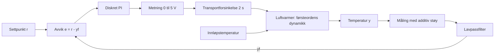

# Kontrollteori: simulert temperaturregulering av en luftvarmer

## Formål og avgrensning

Målet er å utvikle og undersøke en diskret PI-regulering av en luftvarmer.
Arbeidet omfatter modell, diskretisering, regulatorinnstilling, lavpassfilter,
frekvensrespons, stabilitet og simulering av relevante driftssituasjoner.
Fysisk testing er utelatt etter avklaring med faglærer, opplyst av studenten.
Alle temperaturkurver og resultater er simulert. Modellen er kontrollert matematisk,
men er ikke validert mot målinger fra en fysisk luftvarmer.

Arbeidet dekker kontrollteoridelen av del 1. Database, sky, kommunikasjon og den
samlede systemintegrasjonen behandles separat. Et system kan fungere godt mot
denne modellen uten at det beviser tilsvarende ytelse på en virkelig prosess.

## Systemskisse



Regulatoren mottar den filtrerte målingen, ikke simulatorens sanne temperatur.
Sann temperatur er bare tilgjengelig for evaluering av simuleringen.
Innløpstemperaturen er en prosessforstyrrelse; målestøy legges til i målingen
og endrer ikke prosesstilstanden direkte.

## Modell og parametere

Den kontinuerlige modellen er

\[
\frac{dT}{dt}=\frac{-T(t)+K_h u(t-\theta_d)+T_{env}(t)}{\theta_t}.
\]

| Parameter | Verdi | Grunnlag |
|---|---:|---|
| Prosessforsterkning K_h | 3,5 °C/V | Kursmaterialet, side 16 |
| Tidskonstant theta_t | 22 s | Kursmaterialet, side 16 |
| Transportforsinkelse theta_d | 2 s | Kursmaterialet, side 16 |
| Nominell innløpstemperatur T_env | 21,5 °C | Kursmaterialet, side 16 |
| Samplingstid Ts | 0,1 s | Valgt, også brukt i kursmaterialet side 20 |
| Pådrag u | 0 til 5 V | Modellens pådragsgrense, samsvarer med kodeeksemplene i kursmaterialet |
| Målefilterets tidskonstant Tf | 2 s | Valgt og evaluert i denne studien |
| Målestøy | Normalfordelt, sigma = 0,15 °C | Valgt testbetingelse, ikke målt sensorstøy |
| Tilfeldighetsfrø | 20261115 | Gir repeterbare støyforsøk |

Modellen er en forenkling med konstant forsterkning og tidskonstant. Den inkluderer
ikke varierende luftstrøm, temperaturavhengige varmetap eller sensorkvantisering.
Ved konstant pådrag er likevektstemperaturen

\[
T_\infty=T_{env}+K_h u.
\]

Ved nominelle forhold er høyeste oppnåelige likevekt 21,5 + 3,5 · 5 = **39 °C**.
Settpunktet 34 °C er oppnåelig. Ved innløpstemperatur 18,5 °C er maksimum 36 °C,
slik at 34 °C fremdeles er oppnåelig. Et settpunkt på 45 °C er bevisst uoppnåelig.

## Diskretisering og kontrollalgoritme

Med forover Euler erstattes den deriverte av (T[k+1] - T[k])/Ts:

\[
T[k+1]=T[k]+\frac{T_s}{\theta_t}
\left(-T[k]+K_hu[k-N_d]+T_{env}[k]\right).
\]

Her er Nd = theta_d/Ts = 20 prøver. Forsinkelsen implementeres som en kø av
tidligere pådrag. For andre forsinkelser avrundes til nærmeste hele prøve;
de valgte forsinkelsene i denne studien er eksakte multipler av Ts.
Ts/theta_t = 0,00455 gir et lite integrasjonstrinn relativt til prosessdynamikken.

PI-regulatoren utledes fra u = Kp e + (Kp/Ti) integral(e dt). Bakover Euler gir
den inkrementelle formen

\[
e[k]=r[k]-y_f[k],\qquad
u^*[k]=u[k-1]+K_p(e[k]-e[k-1])+K_p\frac{T_s}{T_i}e[k].
\]

\[
u[k]=\min(5,\max(0,u^*[k])).
\]

Den mettede verdien lagres som forrige pådrag. Dermed finnes ingen separat
integrator som fortsetter å akkumulere utenfor pådragsgrensene. Dette er en
enkel beskyttelse mot integraloppbygging; metning gjør samtidig sløyfen ulineær.
Faktoren Ts i integralleddet er nødvendig når Ti angis i sekunder.

Lavpassfilteret implementeres med bakover Euler:

\[
y_f[k]=(1-\alpha)y_f[k-1]+\alpha y_m[k],\qquad
\alpha=\frac{T_s}{T_f+T_s}=\frac{0,1}{2,1}.
\]

Ved Tf = 0 passerer målingen ufiltrert. Filteret demper støy, men tilfører
faseforsinkelse og kan derfor redusere stabilitetsmarginene.

Hvert simuleringstrinn leser T[k], legger til målestøy, oppdaterer filteret,
beregner u[k] og oppdaterer deretter prosessen til T[k+1]. Forsøkene starter i
likevekt ved 28 °C, med u = (28 - 21,5)/3,5 = 1,8571 V i forsinkelseskøen.
Filteret starter på 28 °C og regulatoren på samme likevektspådrag. Ved første
oppdatering initialiseres forrige avvik fra nåværende avvik for å unngå et
vilkårlig proporsjonalsprang. Settpunktendringene skjer først ved t = 20 s.

## Åpen sløyfe og numerisk kontroll

For et sprang fra 0 til 1 V ved t = 0, med start på 21,5 °C, er den analytiske
responsen konstant frem til 2 s og deretter

\[
T(t)=21,5+3,5\left(1-e^{-(t-2)/22}\right),\quad t\geq2.
\]

Sluttverdien er 25 °C. Ved t = 24 s skal 63,2 % av temperaturøkningen være oppnådd.
Største avvik mellom Euler-simuleringen og den analytiske løsningen over 150 s
er **{{EULER_ERROR}} °C**. Dette kontrollerer numerikken mot den samme matematiske
modellen; det er ikke eksperimentell validering av modellen.


## Ziegler-Nichols' frekvensresponsmetode

Overføringsfunksjonen fra endring i pådrag til endring i temperatur er

\[
P(s)=\frac{3,5}{22s+1}e^{-2s}.
\]

For ren P-regulering finnes den kritiske frekvensen ved

\[
-\arctan(22\omega_u)-2\omega_u=-\pi.
\]

Deretter beregnes Ku = 1/|P(j omega_u)| og Pu = 2 pi/omega_u.
Numerisk fås **Ku = {{KU}} V/°C** og **Pu = {{PU}} s**.
ZN-tabellen for PI gir Kp = 0,45 Ku = **2,304 V/°C**, Ti = Pu/1,2 = **6,438 s**.
Dette er frekvensresponsmetoden, ikke ZN-metoden basert på åpen sløyfes sprangkurve.
Forsinkelsen behandles eksakt som exp(-j omega theta_d) i frekvensplanet.

Denne ZN-beregningen gjelder den kontinuerlige prosessen uten målefilter.
Innstillingen brukes som utgangspunkt, og må undersøkes på nytt når regulatoren
diskretiseres og filteret settes inn. Som et roligere alternativ undersøkes
**Kp = 0,52 V/°C og Ti = 18 s**, som også brukes i kursmaterialet side 40.
Vi hevder ikke at dette er et globalt optimum.

## Frekvensrespons og stabilitet for implementasjonen

For å analysere den faktiske implementasjonen brukes de diskrete funksjonene:

\[
P_d(z)=\frac{b z^{-(N_d+1)}}{1-a z^{-1}},\quad
a=1-T_s/\theta_t,\quad b=K_h(1-a),
\]

\[
C_d(z)=K_p\left(1+\frac{T_s}{T_i(1-z^{-1})}\right),\qquad
F_d(z)=\frac{\alpha}{1-(1-\alpha)z^{-1}}.
\]

Den ekstra z^-1 i prosessmodellen skyldes at u[k] virker på tilstanden T[k+1].
Sløyfefunksjonen er Ld = Cd Pd Fd, evaluert på z = exp(j omega Ts).
GM beregnes ved første fasekryssing på -180°, og PM ved første kryssing av 0 dB.
Frekvenssøkene begrenses til under Nyquist-frekvensen pi/Ts = 31,416 rad/s.
Figuren viser det relevante området opp til 3 rad/s; beregningen bruker hele
området under Nyquist.

Som uavhengig stabilitetskontroll finnes røttene i det diskrete karakteristiske
polynomet 1 + Ld = 0. Alle poler må ligge innenfor enhetssirkelen, |z| < 1.
Dette trenger ingen Padé-approksimasjon. Marginene og polene gjelder linearisert
drift uten metning; de beskriver ikke alle egenskaper ved den mettede sløyfen.

{{MARGINS}}


ZN med 2 s filter er nominelt stabil, men har bare omtrent **0,38° fasemargin**.
De langsomt avtagende svingningene er derfor forventet. Den valgte PI-regulatoren
med filter har omtrent **65,26° fasemargin og 16,42 dB forsterkningsmargin**.

Den kontinuerlige analysen uten filter gir til sammenligning omtrent 75,06° og
19,47 dB for samme Kp og Ti. Disse større marginene beskriver en annen sløyfe
og brukes derfor ikke som hovedresultat for implementasjonen med filter.

## Settpunktendringer og ytelse

Det store spranget er fra 28 til 34 °C ved 20 s. Ingen målestøy eller prosess-
forstyrrelse er aktiv i dette forsøket. Oversving oppgis i prosent av spranget
på 6 °C. Innsvingning er første tidspunkt etter spranget der sann temperatur
blir værende innenfor ±2 % av spranget, altså ±0,12 °C, resten av forsøket.
IAE er trapesintegralet av |r - T| fra 20 til 350 s. Metning er andel prøver
på 0 eller 5 V i samme tidsvindu.

{{STEP}}


Den valgte PI-regulatoren når 2 %-båndet etter omtrent 29,9 s og har omtrent
0,40 % oversving. ZN uten filter har nesten ingen oversving i akkurat dette
store spranget. Det skyldes blant annet at pådraget mettes og den inkrementelle
regulatoren lagrer det mettede pådraget: stor-signalresponsen kan ikke tolkes
som responsen til den ubegrensede lineære sløyfen.

Derfor gjennomføres også et lite sprang fra 28 til 28,2 °C. Her er 2 %-båndet
±0,004 °C. IAE gjelder samme tidsvindu, men et mindre sprang, og må ikke
sammenlignes direkte med IAE fra 6 °C-spranget.

{{SMALL_STEP}}


Den valgte regulatoren gir omtrent 4,29 % oversving i det lille spranget,
tilsvarende 0,0086 °C, og god demping også uten metning. ZN med filter er
svært svakt dempet. Et tomt innsvingningsresultat betyr at sløyfen ikke har
blitt værende i toleransebåndet innen den simulerte horisonten, ikke at den
nødvendigvis er matematisk ustabil.

## Forstyrrelse, støy og filter

I forstyrrelsesforsøket endres settpunktet fra 28 til 34 °C ved 20 s.
Ved 150 s reduseres T_env fra 21,5 til 18,5 °C. Innløpsforstyrrelsen påvirker
temperaturens deriverte, og gir ikke et øyeblikkelig sprang i utløpstemperaturen.
Målestøy med sigma = 0,15 °C er aktiv gjennom hele forsøket.

Største avvik fra 34 °C etter forstyrrelsen er omtrent **0,95 °C**.
Gjennomsnittlig avvik de siste 20 s av forsøket er omtrent **0,017 °C**.
Denne restverdien er fra én endelig simulering med støy, og er ikke et bevis
på et permanent reguleringsavvik. Det nødvendige nye likevektspådraget er
(34 - 18,5)/3,5 = **4,429 V**, som er innenfor pådragsgrensen.


I et eget støyforsøk holdes settpunktet konstant på 28 °C i 150 s.
Filter av/på kjøres med identisk støysignal. Statistikk beregnes fra 50 til 150 s.
Standardavviket til pådraget reduseres fra omtrent **0,0800 V til 0,0137 V**,
omtrent **83 % reduksjon**. Standardavviket til målefeilen etter filtrering er
omtrent 0,0253 °C, mot omtrent 0,1529 °C uten filter.

Filteret gir ikke automatisk mindre variasjon i selve prosesstemperaturen:
standardavviket i sann temperatur er omtrent 0,0118 °C uten filter og 0,0128 °C
med filter i dette forsøket. Fordelen her er først og fremst roligere pådrag
og målesignal; ulempen er ekstra faseforsinkelse.


## Metning og stabilitetsgrense

Ved 20 s settes referansen til 45 °C, over modellens maksimum på 39 °C.
Ved 200 s settes referansen tilbake til 28 °C. Temperaturen kan ikke nå 45 °C,
selv om integralleddet forsøker å redusere avviket. Pådraget holdes innenfor
0 til 5 V. Etter retur reduseres pådraget, og temperaturen vender tilbake mot
28 °C. Ingen målestøy er brukt i dette forsøket.


Med Ti = 18 s og Tf = 2 s er kritisk proporsjonalforsterkning omtrent
**Kp,krit = 3,4436 V/°C**. Vi demonstrerer også Kp = 1,2 Kp,krit = 4,1324 V/°C.
Dette gir en polradius omtrent 1,00276, altså lineær ustabilitet. Svingningene
vokser før pådragsgrensene påvirker forløpet. Begrenset temperaturamplitude
ved metning må ikke forveksles med asymptotisk stabilitet rundt settpunktet.


## Følsomhet for modellparametere

Den valgte PI-regulatoren med filter er også analysert ved 27 kombinasjoner:
K_h = 0,8, 1,0 og 1,2 ganger nominell verdi; theta_t = 0,8, 1,0 og 1,2 ganger
nominell verdi; theta_d = 1, 2 og 3 s. Regulatorparametrene holdes uendret.
Alle kombinasjoner har polradius under 1. Laveste GM er **{{MIN_GM}}** som
lineær faktor, laveste PM er **{{MIN_PM}}°**, og største polradius er
**{{MAX_RADIUS}}**. Disse ytterpunktene kan stamme fra forskjellige kombinasjoner.

Dette er en avgrenset parameterstudie av lineær stabilitet. Den beviser ikke
robusthet for alle mellomliggende parametere, andre prosessmodeller eller
ulineær drift med metning. Alle kombinasjoner ligger i data/robustness.csv.

## Vurdering og valgt løsning

ZN-metoden gir en beregnbar og etterprøvbar startinnstilling, men målefilteret
reduserer dempingen kraftig for denne innstillingen. Vi velger derfor
**Kp = 0,52 V/°C, Ti = 18 s, Tf = 2 s og Ts = 0,1 s**.
Valget begrunnes med god demping, små oversving, gode stabilitetsmarginer og
vesentlig mindre variasjon i pådraget ved målestøy. Den simulerte regulatoren
håndterer også innløpsforstyrrelsen og returnerer fra metning.

Konklusjonen gjelder den oppgitte modellen og testbetingelsene. Parametrene er
ikke identifisert fra egne målinger, og støy og forstyrrelser er valgte scenarioer.
Ingen fysiske forsøk eller resultater påstås.

## Reproduksjon, filer og verifikasjon

Fra LAB 3-mappen, med Python og prosjektets analyseavhengigheter installert:

```powershell
python -m pip install -e "./code[analysis]"
python code/tests/test_airheater.py
python code/tests/test_sampled_analysis.py
python code/demos/control_study.py
```

Siste kommando regenererer denne rapporten, åtte figurer i PNG og SVG, CSV-data
og results.json. Den bruker ingen maskinvare, nettverk eller skytjenester.
På en PC der python-kommandoen ikke peker på en installasjon, må riktig Python-
programbane brukes. Beregningene er kontrollert med 42 eksisterende tester og
fire nye tester av den diskrete analysen. De nye testene sammenligner beregnet
frekvensrespons med sinusforsøk i tidsdomenet, kontrollerer polene ved
stabilitetsgrensen og kontrollerer grensen mot kontinuerlig analyse når Ts → 0.

Relevante kildefiler: code/airheater/simulation/model.py,
code/airheater/control/controller.py, code/airheater/control/filters.py,
code/airheater/analysis/sampled.py og code/demos/control_study.py.

## Forslag til muntlig gjennomgang

1. Vis systemskissen og forklar hvilke størrelser regulatoren faktisk kjenner.
2. Forklar modellparametrene og hvorfor transportforsinkelse er tatt med.
3. Vis åpen sløyfe og sammenlign med den analytiske løsningen.
4. Utled diskret prosessmodell og PI-regulator; forklar Ts i integralleddet.
5. Vis beregningen av Ku, Pu og ZN-innstillingen.
6. Vis Bode-diagrammet og forklar hvorfor filteret endrer stabiliteten.
7. Sammenlign store og små settpunktendringer og pek på metning i pådraget.
8. Vis forstyrrelse, støyfilter og retur fra et uoppnåelig settpunkt.
9. Begrunn valgt regulator og oppgi begrensningene ved simuleringen.

## Kilder

- [Oppgavebeskrivelsen](../../Task%20description.pdf), særlig side 3 og 10-11:
  krav til modell, PI, filter, frekvensrespons og ZN-metoden. Kravet til fysisk
  testing er fraveket etter læreravklaringen opplyst av studenten.
- [Control System with Python - Air Heater System](../../Control%20System%20with%20Python%20-%20Air%20Heater%20System.pdf),
  Hans-Petter Halvorsen, særlig side 16, 20, 27, 40 og 45-47: modellverdier,
  diskretisering, overføringsfunksjon og kodeeksempler.
- Prosjektets eksisterende implementasjon av modell, PI, filter og ZN-metode.
  Nye beregninger av diskret sløyfe med filter og alle resultater i denne
  rapporten genereres av control_study.py.
